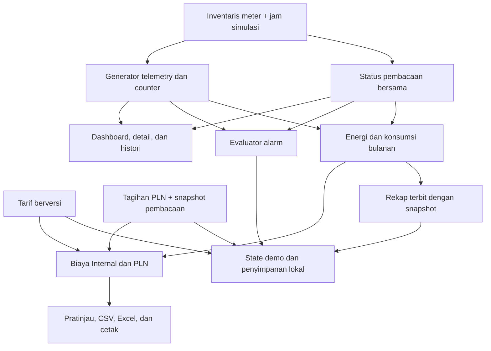

# Handoff — Sakuratex Power Meter

Tanggal serah terima teknis: **10 November 2026**  
Versi aplikasi: **0.7.0**  
Status: **sandbox lokal dengan data simulasi dan database akun SQLite**
Penerima: pengembang lanjutan, QA, dan tim integrasi perangkat.

Dokumen ini menjelaskan kondisi kode setelah audit integrasi terakhir. Ini bukan
berita acara persetujuan produksi. Perubahan masih berada di working tree lokal;
belum ada commit rilis atau deployment baru yang dibuat pada sesi handoff ini.

## 1. Ringkasan yang diserahkan

Aplikasi menyediakan pemantauan listrik per mesin, histori, alarm, perhitungan
Internal dan PLN, rekap energi, pengaturan tarif/aturan, serta ekspor laporan.
Pengukuran dan counter menggunakan generator bersama. Konfigurasi dan transaksi
demo disimpan di browser.

| Area | Kondisi saat diserahkan |
| --- | --- |
| Dashboard dan meter | Lima titik ukur contoh; detail, grafik, parameter, serta skenario koneksi memakai sumber bersama. |
| Energi dan biaya | Konsumsi dari selisih counter; perbandingan dibagi menjadi **Perhitungan Internal** dan **Perhitungan PLN**. |
| Tarif | Satu tarif Internal, tarif PLN LWBP, dan tarif PLN WBP. Tarif ditampilkan pada perhitungan dan disimpan per versi. |
| Alarm | Over voltage, under voltage, overload, dan low PF; replay, pengakuan, catatan, dan pemulihan berbasis sampel simulasi. |
| Laporan | Pratinjau, CSV, Excel, dan cetak memakai data laporan yang sama setelah filter diterapkan. |
| Rekap terbit | Contoh penerbitan Oktober 2026 menyimpan snapshot nilai dan konfigurasi; penerbitan ulang periode yang sama diblokir. |
| Login dan akses | Akun dan role diverifikasi dari SQLite; sesi bertanda tangan melalui cookie HttpOnly selama delapan jam. Admin dapat membuat, mengubah role, menonaktifkan, dan reset password akun. |
| Integrasi produksi | Database akun masih SQLite lokal; belum terhubung ke meter fisik, ThingsBoard, database pusat, atau direktori akun produksi. |

## 2. Menjalankan proyek

Gunakan Node.js 22.13 atau lebih baru karena database akun memakai `node:sqlite`. Lingkungan lokal menggunakan Node.js 24.13.1.

```sh
npm ci
npm run dev
```

Buka **http://127.0.0.1:5173/**. Script menjalankan Next.js dengan webpack pada
host dan port tersebut.

Akun awal untuk Admin, Supervisor, Operator, dan Accounting dibuat otomatis saat
`npm run dev` atau `npm run build`. Email tetapnya adalah `admin@sakuratex.id`,
`supervisor@sakuratex.id`, `operator@sakuratex.id`, dan
`accounting@sakuratex.id`. Password awal semua akun adalah `Demo123` dan tercantum di
`.generated/initial-user-credentials.json`; simpan file ini secara privat. File akun
memiliki permission pemilik saja dan folder `.generated/` diabaikan Git. Admin dapat
mengelola akun di Settings → User access. Database tersimpan di `.data/users.sqlite`;
`AUTH_DATABASE_PATH` dapat menunjuk ke volume persisten.

Untuk menjalankan hasil build lokal:

```sh
npm run build
npm start
```

`npm ci`, `npm run dev`, dan `npm run build` memiliki lifecycle script yang
menyiapkan kunci sesi dan akun awal jika belum ada. File lokal di `.generated/`
dan database `.data/` diabaikan Git. `DEMO_SESSION_SECRET` dapat disediakan pada
environment server untuk menstabilkan kunci sesi; nilainya tidak disertakan dalam
handoff atau disimpan ke Git.

## 3. Halaman dan alur penggunaan

| URL | Fungsi |
| --- | --- |
| `/login` | Masuk ke sesi demo. |
| `/` | Ringkasan mesin dan akses dashboard per mesin. |
| `/meters` | Daftar meter, pencarian, kondisi data, detail, dan histori. |
| `/alarms` | Kejadian aktif/pulih, detail, pengakuan, catatan, serta replay. |
| `/energy/accounting` | Konsumsi dan biaya Internal. |
| `/energy/pln` | Biaya energi berdasarkan kategori LWBP/WBP. |
| `/energy/monthly` | Counter awal/akhir, konsumsi, serta contoh penerbitan rekap. |
| `/reports` | Pilih jenis/periode/meter/versi tarif, terapkan filter, lalu ekspor. |
| `/settings` | Inventaris, tarif, aturan alarm, matriks persona, dan audit lokal. |

Pilihan energi dibawa pada query `period`, `meter`, dan `tariff`. Halaman server
memvalidasi query sebelum meneruskannya ke workspace. Menu Laporan mempunyai
filter tersendiri; perubahan form baru berlaku setelah **Terapkan filter laporan**.

## 4. Peta kode

| Lokasi | Tanggung jawab |
| --- | --- |
| `app/` | App Router, layout, halaman, metadata, dan route login/logout. |
| `components/dashboard.tsx` | Shell aplikasi, navigasi, persona, dan daftar panel. |
| `components/modules/` | Workspace dashboard, monitoring, energi, PLN, alarm, laporan, dan pengaturan. |
| `lib/data.ts` | Inventaris dan beban nominal lima meter contoh. |
| `lib/simulation.ts` | Jam simulasi, jeda/langkah sampel, status koneksi, dan replay pengukuran. |
| `lib/telemetry.ts` | Generator pengukuran, histori, dan counter pada batas waktu. |
| `lib/reading-state.ts` | Definisi bersama umur data dan sampel terakhir yang tersedia. |
| `lib/measurements.ts` | Pembacaan yang dikonsumsi UI dan histori, termasuk override replay. |
| `lib/automatic-alarms.ts` | Evaluator alarm, durasi, hysteresis, dan pemulihan. |
| `lib/demo-store.ts` | State bersama, validasi/migrasi data lokal, tarif, tagihan, rekap, serta audit. |
| `lib/domain.ts` | Helper konsumsi/biaya, skema validasi, persona, dan format WIB. |
| `lib/report-period.ts` | Batas bulan WIB dan pemeriksaan timestamp dalam periode. |
| `lib/energy-reports.ts` | Data energi dan format laporan bersama untuk halaman/ekspor. |
| `lib/cost-gap.ts` | Perbandingan seluruh biaya mesin dengan tagihan PLN. |
| `lib/reports.ts` | Kontrak `Report`, CSV, workbook XLSX, dan unduhan. |
| `components/modules/shared.tsx` | Tabel, pratinjau laporan, tombol ekspor, serta target cetak. |
| `lib/demo-auth.ts`, `proxy.ts` | Sesi demo dan penjagaan route aplikasi. |
| `tests/`, `audit/*.test.*` | Pengujian otomatis dan regresi audit. |
| `.github/workflows/ci.yml` | Workflow lint, typecheck, test, dan build dengan Node.js 22. |

**Catatan pengembangan:** ikuti `AGENTS.md`. Sebelum mengubah kode Next.js, baca
panduan yang relevan di `node_modules/next/dist/docs/`; jangan mengasumsikan API
versi lama. Stack utama: Next.js 16.4.5, React 19.3.1, TypeScript 5.9.3,
Tailwind CSS 4, Radix UI, React Hook Form, Zod, dan Vitest.

## 5. Alur data bersama



Aturan yang harus dipertahankan ketika melanjutkan pengembangan:

1. Gunakan ID meter dan timestamp sampel yang sama untuk membandingkan angka antarhalaman.
2. Umur data ≤30 detik berarti terkini; >30 sampai 120 detik berarti terlambat dan memakai sampel terakhir; >120 detik berarti terputus. Nilai yang hilang ditampilkan `—`/`null`, bukan nol.
3. Umur sampel yang ditahan bertambah saat jam simulasi maju. Gunakan `meterReading`, bukan definisi koneksi baru pada setiap komponen.
4. Batas bulan adalah pukul 00.00 WIB, dengan awal periode inklusif dan awal bulan berikutnya eksklusif.
5. Gunakan `buildEnergyReport` dan `energyReportView` bersama untuk tampilan dan keluaran energi. Hindari menyalin rumus ke komponen laporan lain.
6. Alarm yang diakui belum tentu pulih. Pemulihan membutuhkan bukti sampel normal sesuai aturan; event mempertahankan konfigurasi pemicunya.
7. Perbandingan tagihan PLN selalu mencakup seluruh titik ukur, meskipun filter energi memilih satu mesin.
8. Snapshot tagihan menyimpan `tick` dan `readings` berupa `ages`/`heldTicks`. Status koneksi sesudah penyimpanan tidak boleh menulis ulang kualitas pembanding lama.
9. Snapshot rekap terbit menyimpan nilai laporan dan konfigurasi tarif. Mengubah tarif berikutnya tidak boleh mengubah rekap yang sudah terbit.

Jam simulasi mengikuti waktu sejak epoch sintetis 6 November 2026, 11.10 WIB;
interval sampel sepuluh detik. Histori adalah jendela maksimal 36 sampel terakhir.
Jeda/langkah/replay berlaku pada state sesi aplikasi; ini bukan proses akuisisi
perangkat yang tetap berjalan di server.

## 6. Definisi perhitungan

| Angka | Dasar perhitungan |
| --- | --- |
| Konsumsi | Counter akhir − counter awal periode, dalam kWh. Counter mundur atau tidak tersedia menghasilkan nilai yang perlu rekonsiliasi. |
| Internal | Konsumsi tiap meter × tarif Akunting; total merupakan jumlah biaya per meter. |
| Biaya energi versi PLN | Konsumsi titik terpilih dibagi LWBP 80% dan WBP 20%, lalu dikalikan tarif masing-masing. |
| Total PLN otomatis | Energi model seluruh meter ×104%, dibagi LWBP/WBP 80/20; biaya energi ditambah Rp2.500.000, lalu tambahan 3% atas subtotal tersebut. |
| Total PLN manual | Nominal input pengguna untuk cakupan dan rentang waktu pembanding. Komponen tagihan tidak direka dari satu nominal total. |
| Selisih | Total PLN − total biaya Internal seluruh meter. Persentase memakai Total PLN sebagai pembagi; tidak dihitung bila pembaginya nol. |

Semua persentase, beban tambahan, dan biaya tetap di atas adalah **asumsi demo**.
Biaya energi versi PLN dan Total PLN pembanding mempunyai cakupan berbeda;
keduanya tidak harus bernilai sama. Selisih biaya tidak membuktikan susut energi.

Helper biaya menggunakan scaled BigInt dengan ketelitian input maksimal empat
desimal dan pembulatan half-up ke rupiah. Penjumlahan biaya per meter dapat
berbeda dari satu perkalian agregat karena pembulatan. Ikuti nilai laporan dan
penyesuaian pembulatan yang sudah disediakan.

Tarif awal: Internal Rp1.000/kWh, PLN LWBP Rp1.000/kWh, dan PLN WBP Rp1.500/kWh.
Default mengikuti versi terbaru bila belum dipilih eksplisit. Pemilihan versi lama
tetap dihormati. Tanggal efektif masih metadata skenario; belum ada alokasi
otomatis pemakaian lintas versi tarif di tengah bulan.

## 7. Penyimpanan dan kompatibilitas

| Penyimpanan | Isi dan masa berlaku |
| --- | --- |
| localStorage `sakuratex-demo-v1` | Event/catatan/pengakuan, versi tarif, aturan, audit simulasi, tagihan PLN, dan snapshot rekap. |
| localStorage `sakuratex-sidebar-collapsed` | Preferensi sidebar. |
| localStorage `sakuratex-review` | Catatan review yang tidak dikirim ke tim. |
| State memori | Clock/jeda, koneksi, dan timeline replay pada sesi aplikasi. |
| SQLite `.data/users.sqlite` | Akun, role, status aktif, dan password hash scrypt. Lokasi dapat diatur dengan `AUTH_DATABASE_PATH`. |
| Cookie `sakuratex-demo-session` | Sesi akun bertanda tangan; HttpOnly, SameSite Lax, kedaluwarsa delapan jam. |

Validasi state memakai Zod. Tarif lama tanpa field PLN memakai fallback LWBP/WBP
versi tersebut. Field LWBP/WBP internal lama masih dipertahankan pada data untuk
kompatibilitas, tetapi tidak ditawarkan sebagai input rumus Internal yang kini
memakai satu tarif.

Tagihan periode berjalan dari versi lama yang belum mempunyai snapshot
pembacaan tidak langsung dihitung selisihnya. UI meminta pengguna menyimpan ulang
agar pembanding memakai batas data saat ini. Informasi yang belum pernah disimpan
tidak direkonstruksi seolah-olah merupakan pengukuran historis.

Data lokal tidak disinkronkan antar-tab atau antarperangkat. Logout menghapus
sesi login, bukan seluruh localStorage. Untuk pengujian fixture bersih, gunakan
profil browser terpisah. Penghapusan data situs akan menghilangkan konfigurasi
dan transaksi demo lokal; lakukan hanya bila data tersebut memang boleh dibuang.

## 8. Validasi terakhir

Hasil pada sesi audit 10 November 2026, sebelum penyusunan dokumen ini:

| Pemeriksaan | Hasil |
| --- | --- |
| `npm run typecheck` | Lulus. |
| `npm test` | 109 tes lulus dalam 20 file. |
| `npm run lint` | Lulus. |
| `npm run build` | Build produksi dan generasi route berhasil. |
| `git diff --check` | Lulus sebelum handoff. |

Jalankan ulang secara berurutan pada checkout penerima:

```sh
npm run lint
npm run typecheck
npm test
npm run build
```

Jangan menjalankan typecheck bersamaan dengan build yang mengubah generated
types Next.js. Hasil workflow CI remote belum diverifikasi pada handoff ini.
Pengujian UI memakai jsdom; peringatan canvas pada axe tidak menjadi pemeriksaan
kontras visual atau pengganti UAT browser.

Regresi integrasi utama berada pada `tests/integration-data.test.tsx`: perubahan
tarif melalui form sampai ke laporan, versi eksplisit, snapshot tagihan,
kedaluwarsa pembacaan terlambat, batas WIB, snapshot rekap, dan tagihan lama.

## 9. Checklist penerimaan lokal

- [ ] Instal dependency dari lockfile dan jalankan aplikasi tanpa mengisi kunci sesi secara manual.
- [ ] Login, buka setiap menu, logout, dan pastikan route aplikasi kembali meminta login.
- [ ] Bandingkan satu mesin pada Ringkasan, Panel & Meter, dan histori dengan timestamp yang sama.
- [ ] Pilih Terlambat lalu Terputus; pastikan nilai ditahan atau kosong, bukan berubah menjadi nol.
- [ ] Ubah tiga tarif melalui Pengaturan; verifikasi angka Internal, tarif PLN, dan laporan memakai versi yang dipilih.
- [ ] Pilih satu mesin pada Energi; pastikan subtotal terpilih berubah tetapi cakupan pembanding tagihan tetap seluruh titik.
- [ ] Simpan tagihan PLN, ubah koneksi mesin, dan pastikan pembanding yang tersimpan tetap menggunakan snapshot semula.
- [ ] Replay alarm, akui, tambahkan catatan, lalu replay pemulihan; periksa riwayatnya.
- [ ] Terbitkan rekap Oktober sekali; ubah tarif dan pastikan snapshot terbit tidak berubah.
- [ ] Terapkan filter Laporan, lalu periksa CSV, Excel, dan pratinjau cetak.
- [ ] Periksa tampilan desktop dan mobile; catat browser serta hasil aktual.

Checklist ini disiapkan untuk penerima dan belum dianggap sudah ditandatangani.
PIC penerima, tanggal penerimaan, hasil UAT, dan persetujuan bisnis belum ditetapkan.

## 10. Pekerjaan lanjutan menuju produksi

| Prioritas | Pekerjaan | Hasil yang diperlukan |
| --- | --- | --- |
| P0 | Kontrak integrasi meter dan topologi | ID perangkat, register/unit, CT/PT, induk/anak, timestamp, interval, serta contoh payload yang disepakati tim perangkat dan pengembang. |
| P0 | Backend telemetry dan database | Akuisisi, validasi, kualitas data, penyimpanan historis, dan API bersama yang menggantikan generator serta state lokal. |
| P0 | Akun dan otorisasi server | Identitas pengguna nyata, pembatasan peran/area, audit server, pengelolaan sesi, dan backup/restore. |
| P0 | Pengesahan perhitungan | Tarif aktual pabrik, kalender LWBP/WBP, pajak/komponen tagihan, perubahan tarif, counter reset, dan aturan tutup buku. |
| P1 | Alarm operasional | Threshold/durasi/hysteresis disahkan, PIC/shift, retensi, kebutuhan notifikasi, serta escalation. |
| P1 | Periode dan laporan produksi | Kalender umum, scheduler tutup bulan, rekonsiliasi, revisi snapshot, serta ekspor data besar. |
| P1 | Deployment dan observabilitas | Environment, penyimpanan secret, log, monitoring, runbook insiden, dan proses rilis/rollback. |
| P1 | UAT dan rekonsiliasi nyata | Pencocokan meter fisik, tagihan, browser/mobile, beban data, pilot, dan penerimaan pengguna. |

Saat ini UI periode dibatasi Oktober/November 2026; penerbitan contoh dibatasi
Oktober. Semua titik dianggap eksklusif pada fixture. Dukungan kalender umum,
topologi nyata, notifikasi eksternal, dan integrasi cloud bukan fitur yang sudah
diserahkan. Tim/PIC pelaksana tiap pekerjaan di atas masih perlu ditetapkan.

## 11. Dokumen pendamping dan langkah pertama penerima

- [README](README.md): perintah dan gambaran aplikasi.
- [Audit integrasi terbaru](audit/AUDIT-INTEGRASI-DATA-2026-11-10.md): temuan, perbaikan, dan batas audit.
- [Status implementasi](IMPLEMENTATION-STATUS.md): riwayat fase dan penghalang go-live; gunakan pembaruan audit terbaru untuk kondisi saat ini.
- [Panduan review](REVIEW-GUIDE.md): referensi alur review awal; beberapa label/fixture mencerminkan versi sebelumnya.
- [Audit terdahulu](audit/PERBAIKAN-AUDIT-2026-11-06.md): riwayat perbaikan alarm dan cetak.

Penerima sebaiknya mulai dengan menjalankan pemeriksaan lokal, meninjau diff
working tree, lalu melakukan checklist penerimaan. Working tree juga memuat
perubahan sebelumnya pada layar login dan lockfile; jangan menganggap seluruh
diff hanya berasal dari audit integrasi. Setelah review, buat commit/release yang
jelas sebelum memulai penggantian sumber simulasi dengan integrasi nyata.
